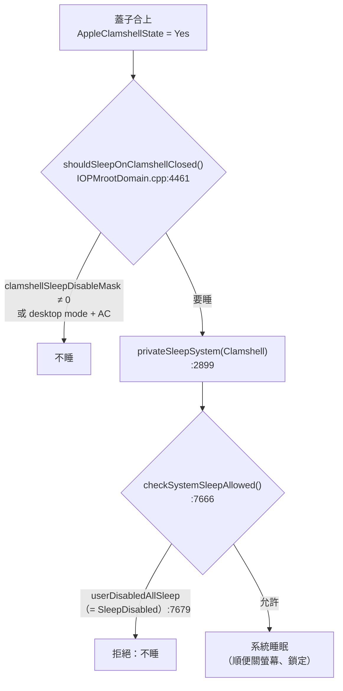
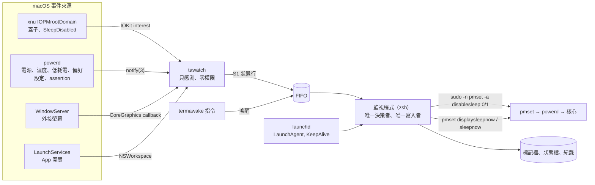
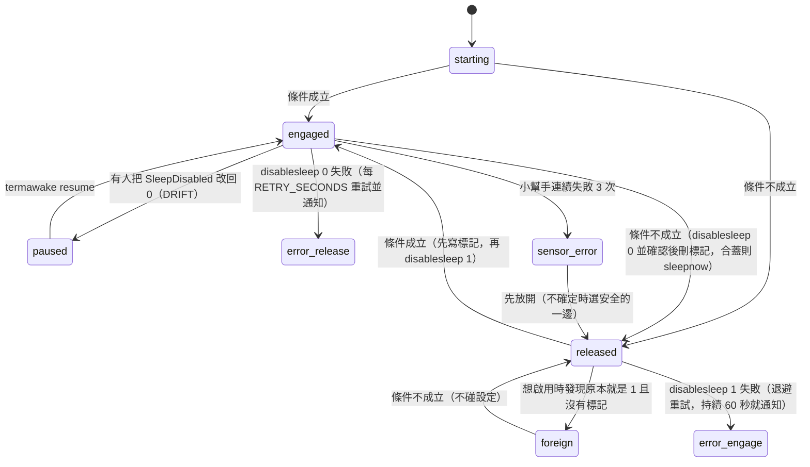
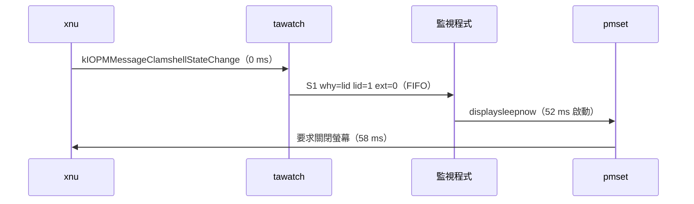

# TermAwake

> **只要 Terminal 開著，MacBook 合上蓋子也不會睡；Terminal 一關，立刻恢復原本的睡眠行為。**
> 完全由事件驅動、不輪詢，並補上 `SleepDisabled` 擋掉的過熱、低電量安全網。

 

**一般使用者請直接看 → [使用指南 docs/USER_GUIDE.md](docs/USER_GUIDE.md)**（一步一步的安裝、驗證、設定、常見問題）。這份 README 是工程文件：說明問題怎麼定義、為什麼這樣設計、怎麼證明它是對的。

---

## Abstract

TermAwake keeps a MacBook awake — including with the lid closed, on battery and without an external display — while a terminal application is running, and restores normal sleep the moment it is no longer needed. On Apple Silicon the only reliable lever is the kernel's global `SleepDisabled` flag (`pmset -a disablesleep`), which also suppresses macOS's own thermal- and power-emergency sleep; TermAwake therefore treats compensating for those side effects as a first-class requirement. The design separates an unprivileged, fully event-driven sensor (`tawatch`, Objective-C) from a single decision-maker and actuator (a zsh state machine) that alone may toggle the flag through a two-command `sudoers` rule. Crash consistency comes from a write-ahead marker protocol plus launchd supervision. On a MacBook Air (M5, macOS 26.6), lid-close-to-display-off latency is 58 ms (1.22 s in v1.2), app-quit-to-release 28 ms, and steady-state overhead is 0.056 ms of CPU per second with 0.02 wake-ups per second (≈4 µW of CPU energy), a 116× reduction. Correctness is checked by 165 scenario tests against a simulated environment and by mutation testing (9 of 10 mutants killed).

## 摘要

TermAwake 解決的問題：MacBook 在合蓋、用電池、沒接外接螢幕時，一定會進入睡眠，讓 Claude Code 這類長時間工作中斷。在 Apple Silicon 上，唯一可靠的開關是核心的 `SleepDisabled`。但它同時會擋掉 macOS 自己的過熱緊急睡眠與低電量緊急睡眠，所以本專案把「補回這些安全網」當成和「不睡」同等級的需求。架構上把**感測**（無權限、完全事件驅動的 Objective-C 小程式）和**決策／執行**（唯一能改設定的 zsh 狀態機）分開。當機一致性由「先寫標記、再改設定」的協定和 launchd 監督保證。實測：合蓋到關螢幕 58 ms、結束 Terminal 到恢復睡眠 28 ms、常駐成本每秒 0.056 ms CPU。正確性由 165 項模擬情境測試與突變測試（10 個突變抓到 9 個）驗證。

---

## 目錄

0. [快速上手](#0-快速上手)
1. [問題定義與需求](#1-問題定義與需求)
2. [背景：macOS 怎麼決定合蓋要不要睡](#2-背景macos-怎麼決定合蓋要不要睡)
3. [相關工作](#3-相關工作)
4. [設計決策](#4-設計決策)
5. [系統設計](#5-系統設計)
6. [實作](#6-實作)
7. [評估](#7-評估)
8. [限制與效度威脅](#8-限制與效度威脅)
9. [工程紀錄：踩過的坑](#9-工程紀錄踩過的坑)
10. [未來工作](#10-未來工作)
11. [專案結構、參考資料、授權](#11-專案結構參考資料授權)

---

## 0. 快速上手

**需求**：macOS（Apple Silicon，在 macOS 26.6 測試）、管理員帳號、Xcode 命令列工具（`xcode-select --install`；`git clone` 本身也需要）。

```bash
git clone https://github.com/Jhongwe1/TermAwake.git
cd TermAwake
./install.sh          # 會問一次 Mac 登入密碼（建立只允許兩條指令的免密碼規則）
termawake doctor      # 健康檢查
```

| 指令 | 用途 |
|---|---|
| `termawake` | 目前狀態（感測值、判斷結果、原因） |
| `termawake pause` / `resume` | 暫停／恢復（暫停在 Terminal 結束或重開機後自動解除） |
| `termawake doctor` | 唯讀健康檢查，結束碼 0／1／2 |
| `termawake config` | 目前設定與被修正過的值 |
| `termawake log [-f]` | 決策紀錄 |
| `termawake restore` | 緊急：立刻 `SleepDisabled=0` 並暫停 |
| `termawake uninstall` | 完整移除 |

設定檔在 `~/Library/Application Support/TermAwake/config`，共 15 項，每一項都附說明、範圍、預設值和建議值，存檔即生效（[§6.3](#63-設定介面)）。

---

## 1. 問題定義與需求

### 1.1 動機

AI 程式代理（Claude Code 等）一次工作常常要幾分鐘到幾小時。使用者希望可以合上蓋子帶著走，或是蓋著放在桌上、用手機遠端控制，讓工作繼續跑。macOS 的預設行為是合蓋就睡，所有程序和網路都會停。

### 1.2 為什麼現有機制不夠

- **`caffeinate`／IOPMAssertion 擋不住合蓋。** xnu 判斷合蓋要不要睡的函式完全不看 assertion：
  `shouldSleepOnClamshellClosed() = !clamshellDisabled && !(desktopMode && acAdaptorConnected) && !clamshellSleepDisableMask`（`IOPMrootDomain.cpp:4461-4471`）。
  只有「接外接螢幕＋接電源」（desktop mode）才不睡。
- **`SleepDisabled` 擋得住，但是一把大鎚。** 它在 `checkSystemSleepAllowed()` 裡讓**所有** `privateSleepSystem()` 都失敗（`:7666`, `:7679`），包括過熱緊急睡眠（`:8672-8674`）和部分的低電量緊急睡眠（`:8695-8717`）。它還會寫進偏好檔，開機時由 powerd 重新套用（`PMSettings.m:1162, 1330-1347`）。此外，`man pmset` 完全沒有提到 `disablesleep`，屬於沒有正式文件的介面。

所以真正的問題不是「怎麼不睡」，而是「**怎麼安全地使用一個會關掉所有安全網的開關**」。

### 1.3 需求

| # | 功能需求 | 驗收方式 |
|---|---|---|
| FR1 | 監視的 App（預設 Terminal）在執行時，合蓋、用電池、無外接螢幕也不睡 | 實機合蓋 19 分鐘無睡眠（§7.5） |
| FR2 | App 結束後立刻恢復；若蓋子合著且無外接螢幕，立刻睡 | ⌘Q → 28 ms 執行恢復（§7.3）；測試 §6、§8 |
| FR3 | 防睡眠期間合蓋要關螢幕（`SleepDisabled` 會連帶擋掉合蓋關螢幕） | 實機 58 ms（§7.3） |
| FR4 | 安全網：低電量、過熱、低耗電模式時恢復睡眠 | 測試 §4–§6、§20、§21；實機低耗電 34 ms |
| FR5 | 當機、`kill -9`、斷電後，設定一定會被收拾 | 標記協定（§5.5）；測試 §11–§14 |
| FR6 | 尊重使用者：暫停／恢復；不碰別人設的 `SleepDisabled`；被別人改回 0 時不搶 | 測試 §9、§15、§22；實機 DRIFT |
| FR7 | 所有可調參數都在設定檔，附建議值；改了立即生效 | 測試 §17 |

| # | 非功能需求 | 目標 | 結果 |
|---|---|---|---|
| NFR1 | 耗電 | 常駐時不輪詢、不開子程序 | 每秒 0.056 ms CPU、0.02 次喚醒（§7.4） |
| NFR2 | 反應時間 | 合蓋到關螢幕 < 300 ms、結束 App 到恢復 < 1 s | 58 ms、28 ms |
| NFR3 | 最小權限 | 只有兩條一字不差的 sudo 指令；感測端零權限 | 符合（§5.7） |
| NFR4 | 隱私 | 零網路、不讀使用者內容 | 符合 |
| NFR5 | 強健性 | 外部指令都有時間上限；不確定時選安全的一邊 | 符合（§5.6 FMEA） |
| NFR6 | 可觀察性 | 每個決策都有原因；異常會通知 | `status`／`log`／`doctor`／通知 |
| NFR7 | 可測試性 | 不需要密碼、不動真實設定也能測完全部邏輯 | 165 項模擬測試 |

### 1.4 限制條件

Apple Silicon、SIP 開啟、不使用 kernel extension、不使用 Apple 私有 entitlement、沒有 Apple Developer ID（開源、在使用者機器上從原始碼編譯）。

---

## 2. 背景：macOS 怎麼決定合蓋要不要睡

### 2.1 決策路徑



過熱緊急睡眠（`privateSleepSystem(kIOPMSleepReasonThermalEmergency)`，`:8674`）和電力緊急時的睡眠（`kIOPMSleepReasonLowPower`，`:8713, :8717`）走的也是同一個 `privateSleepSystem()`，所以**一樣會被 `SleepDisabled` 擋掉**。電力緊急時，Apple Silicon 視情況可能改走「要求使用者空間關機」（`:8709`），但無法保證一定走這條。

另外，核心收到 `SleepDisabled` 只會設定變數 `userDisabledAllSleep`（`:2055-2058`, `:8386-8389`），**不會重新判斷要不要因為合蓋而睡**。所以蓋子已經合著時把設定改回 0，Mac 不會自己睡。這就是 TermAwake 恢復時要主動 `pmset sleepnow` 的原因。

### 2.2 可用機制比較

| 機制 | 權限 | 擋得住合蓋？ | 問題 |
|---|---|---|---|
| IOPMAssertion（`caffeinate`） | 無 | ❌ 只擋閒置睡眠 | — |
| 合蓋睡眠位元（`IOConnectCallScalarMethod` selector 12，`kPMSetClamshellSleepState`） | **無**（`RootDomainUserClient.cpp:388-396, 525-529`：沒有 entitlement、沒有權限檢查） | ✅ | 和 powerd 共用同一個位元：powerd 在睡前（`pmconfigd.m:411`）、醒來後（`:436-437`）、插拔電源時（`BatteryTimeRemaining.m:917-918`）都會重新設定，**合蓋中可能被清掉而突然睡著**。這和 Amphetamine 自己的說明一致：Apple Silicon 上插拔電源會讓合蓋模式失效，所以 5.3 版改成需要管理員權限的 Power Protect |
| `kIOPMAssertionAppliesOnLidClose` | Apple 私有 entitlement（`PMAssertions.c:2571-2576`） | ✅ | 第三方拿不到 |
| 假螢幕轉接頭（dummy display） | 無（硬體） | 只在接電源時 | desktop mode 需要 AC |
| **`SleepDisabled`（`pmset -a disablesleep 1`）** | root | ✅ 可靠 | 擋掉**所有**睡眠，包括緊急睡眠；會寫進偏好檔、開機後還在 |

### 2.3 `SleepDisabled` 的副作用與對策

| 被擋掉的行為 | 後果 | TermAwake 的對策 |
|---|---|---|
| 合蓋睡眠 | （目的） | — |
| 合蓋時關螢幕（平常是睡眠順便做的） | 合著蓋子螢幕還亮 | 收到合蓋事件就 `pmset displaysleepnow` |
| 過熱緊急睡眠 | 包包裡過熱 | 溫度壓力 ≥ `THERMAL_LIMIT`（預設 2）就恢復睡眠，合蓋時立刻睡 |
| 低電量緊急睡眠（部分路徑） | 電池用到硬斷電 | 電量下限 `BATTERY_MIN`（預設 20%，不能低於 5%） |
| 蘋果選單的「睡眠」、閒置睡眠 | 使用者會困惑 | 文件說明；`termawake pause` |
| 寫進偏好檔、開機後重新套用 | 當機後 Mac 可能再也不睡 | 標記協定＋登入後自動收拾（§5.5） |
| 合蓋後的螢幕鎖定 | 改由「螢幕關閉後多久要求密碼」決定 | `doctor` 檢查鎖定延遲並提出建議 |

---

## 3. 相關工作

**研究方法**：開源專案直接讀原始碼；閉源軟體只做靜態檢查（`otool -L`、`nm -u`、`strings`、`codesign -d`），**不執行、不反組譯商業邏輯、不複製程式碼**；Amphetamine 本體透過同作者以 MIT 授權公開的 Amphetamine Enhancer 和官方說明推論。「廠商自述」代表未經驗證。

| 工具 | 底層機制 | 什麼時候不睡 | 偵測方式 | 安全網 | 當機收拾 | 網路 |
|---|---|---|---|---|---|---|
| **TermAwake 1.3** | sudoers（2 條一字不差的指令）→ `pmset` | App 執行中（預設）／有工作時（選用） | **全部事件驅動**，60 秒安全網心跳 | 電量、過熱、低耗電、設定被改、感測失效 | 標記協定＋launchd＋接手 | 無 |
| Sleepless（OSS） | sudoers（同樣兩條） | 手動開關、1～2 小時計時 | 輪詢 | 電量 15%、低耗電 | 宣稱重開機會恢復（與 powerd 原始碼矛盾） | 無 |
| Amphetamine（App Store） | 推論：selector 12；Apple Silicon 需額外的管理員腳本 | 十多種觸發條件 | — | 電量 | Enhancer：每 10 秒的看門狗 | 未知 |
| Hold My Lid（付費） | SMAppService root helper（XPC）→ `pmset` | agent 工作時（hooks＋程序偵測） | 多半事件驅動 | 電量、溫度、低耗電 | 租約（lease） | 含 Aptabase 分析 SDK（靜態檢查） |
| Hold Sleep（付費） | sudoers → `pmset` | 各 App 的 CPU／磁碟／網路＋assertion | 每幾秒取樣 | 電量 20%、低耗電 | 看門狗 | 授權與更新檢查 |
| agent-lid-closed（OSS） | sudoers＋root helper | agent 工作時（hooks） | **每秒查兩次蓋子** | 電量 15%、溫度 | 標記＋launchd | — |
| Adrafinil（OSS） | root helper（只開放 `setSleepBlocked`） | agent 工作時（hooks） | — | 溫度約 60°C、電量 | — | — |
| LidAwake（OSS） | sudoers → `pmset` | 依電源政策 | — | — | 單一寫入的 worker＋標記 | 手動檢查更新 |
| sleep-preventer（OSS） | sudoers（`disablesleep *` 萬用字元） | — | 輪詢 `ioreg` | — | 登入時對帳 | — |

**學來的**：過熱與低耗電保護（Hold My Lid、Sleepless）、用 CoreGraphics 偵測外接螢幕（Hold My Lid）、電源事件通知、收拾者要能在主程式失效時運作（Amphetamine Enhancer）、把錯誤做成通知（Sleepless）、把 assertion 當成「工作中」的訊號（Hold Sleep）。
**刻意不學的**：分析 SDK、HTTP 程序間溝通、讀取 prompt、模擬鍵盤、拿 selector 12 當主機制、sudoers 萬用字元。

---

## 4. 設計決策

| # | 決策 | 考慮過的選項 | 選擇與理由 |
|---|---|---|---|
| D1 | 不睡的機制 | assertion／selector 12／`SleepDisabled`／私有 entitlement | **`SleepDisabled`**：唯一在 Apple Silicon、電池、無外接螢幕下都可靠的公開手段（§2.2）；副作用由安全網補回（§2.3） |
| D2 | 取得 root 的方式 | SMAppService root daemon＋XPC／sudoers | **sudoers，只允許兩條一字不差的指令**。daemon＋XPC 要有 Developer ID 才能用 code-signing requirement 限制呼叫者；ad-hoc 簽章只能釘 cdhash，每次重新編譯都要重裝。sudoers 的攻擊面更小、可稽核 |
| D3 | 程序結構 | 單一原生 daemon／感測與決策分開 | **分開**：感測（Objective-C，零權限，約 390 行程式碼）只回報事實；決策與執行（zsh，約 1,060 行程式碼）是唯一寫入者。決策邏輯可讀、可在假環境完整測試。耗電的關鍵是「不輪詢、不開子程序」，跟決策用什麼語言寫無關 |
| D4 | 偵測方式 | 輪詢／事件 | **事件**＋每 60 秒的安全網心跳（`HEARTBEAT`）。漏掉的事件最晚在一個心跳內補上，心跳也兼做存活檢查 |
| D5 | 「工作中」訊號（選用功能） | Claude Code hooks／CPU 取樣／assertion | **assertion**：Claude Code 只在工作時執行 `caffeinate -i`（§6.4），不必改 `~/.claude/settings.json`。限 `MODE=work` 和 `IDLE_MINUTES` 使用，預設關閉 |
| D6 | 感測小幫手是否必要 | 可選（沒有就退回輪詢）／必要 | **必要**：兩條路徑要維護兩套邏輯和測試；`git clone` 本身就需要 Xcode 命令列工具 |
| D7 | 不確定時怎麼辦 | 一律放開／一律維持 | **分情況**：感測小幫手失效 → 放開（硬體安全優先）。單一感測值讀不到（溫度 -1、工作 -1）→ 不因此放開，`doctor` 標成 ❌。前者是整體失明，後者是罕見的局部失效；如果局部失效也放開，等於工具失去作用 |
| D8 | 和其他工具／使用者的衝突 | 搶回來／讓步 | **讓步**：防睡眠中被改回 0 → 當成使用者覆寫，進入暫停（DRIFT）。原本就是 1（不是自己設的）→ 永遠不碰（FOREIGN） |
| D9 | 預設行為的變更 | 由工程判斷／由使用者決定 | 凡是影響「Mac 什麼時候睡」的預設值，都由使用者決定：`MODE=app`、`THERMAL_LIMIT=2`（不分情況）、`LOW_POWER=release` |

---

## 5. 系統設計

### 5.1 架構



程序樹：`launchd → zsh 監視程式 → 包裝子 shell → tawatch`。包裝子 shell 在 `tawatch` 結束時寫一行 `D`，讓監視程式在毫秒內知道（§6.2）。

### 5.2 程序間協定

所有訊息都寫進同一個 FIFO（權限 600）。每行都小於 `PIPE_BUF`（512 bytes），所以多個寫入者也不會交錯。

| 訊息 | 來源 | 格式 |
|---|---|---|
| 狀態 | tawatch | `S1 gen= pid= why= seq= app= batt= pct= lid= ext= therm= lpm= sd= work=` |
| 小幫手結束 | 包裝子 shell | `D gen=<n> rc=<結束碼>` |
| 喚醒 | CLI | `x` |

| 欄位 | 意義 | 值 |
|---|---|---|
| `gen` | 小幫手世代；重新啟動後舊世代的資料一律丟棄 | 遞增整數 |
| `why` | 觸發原因 | `start tick ping app power lid display thermal lpm prefs work config wake once` |
| `app` | 第一個在執行的監視對象 | 程序名稱或 `-` |
| `batt` | 用電池（含「插著電但電流為負」） | 0／1 |
| `pct` | 電量 | 0～100、-1 = 無電池 |
| `lid` | 蓋子 | 1 合上、0 打開、-1 無蓋子 |
| `ext` | 外接螢幕數 | ≥ 0、-1 = 讀不到 |
| `therm` | 溫度壓力等級（`OSThermalNotification.h`：0 正常 … 4 即將緊急睡眠） | 0～4、-1 |
| `lpm` | 低耗電模式 | 0／1 |
| `sd` | 核心目前的 `SleepDisabled`（`IOPMrootDomain` 屬性） | 0／1／-1 |
| `work` | 符合條件的「保持清醒」assertion 數 | ≥ 0、-1 = 沒有追蹤 |

狀態是**整份快照**（level-triggered），不是增量。所以漏掉一行、或一次讀到好幾行時，以最後一行為準即可。唯一的例外是蓋子：讀到任何 `lid≠1` 都會重設「這次合蓋已經關過螢幕」，避免「開、合」被合併成一次而漏關螢幕。

### 5.3 決策函式

每次醒來（收到訊息或計時器到期）都完整重新判斷，依優先順序：

| 順序 | 條件 | 結果 | 鎖定（latch） |
|---|---|---|---|
| 0 | 感測小幫手失效 | 放開（`sensor-error`） | 恢復即解除 |
| 0' | 還沒收到第一筆感測資料 | 不動作 | — |
| 1 | `MODE=app`：監視對象沒在跑；`MODE=work`：沒有工作且超過 `WORK_GRACE` | 放開，順便解除暫停 | — |
| 2 | 暫停中（只在同一次開機內有效） | 放開 | 直到 resume、App 結束或重開機 |
| 3 | 溫度壓力 ≥ `THERMAL_LIMIT` | 放開 | 連續 `THERMAL_COOLDOWN` 秒低於門檻 |
| 4 | 用電池且電量 < `BATTERY_MIN` | 放開 | 直到接上電源 |
| 5 | 用電池且低耗電模式（`LOW_POWER=release`） | 放開 | — |
| 6 | 合蓋＋用電池＋無外接螢幕＋無工作，持續 `IDLE_MINUTES` | 放開並讓 Mac 睡 | 直到開蓋或接電 |
| — | 以上都不成立 | **禁止睡眠** | — |

放開時，如果蓋子合著、沒有外接螢幕（判斷不出外接螢幕時，只有低電量和過熱才會這樣做），而且不是監視程式本身要結束（可能正在關機或登出）或感測失效，就 `pmset sleepnow`（§2.1 最後一段）。

### 5.4 狀態機



`released` 對應 `app-not-running`、`no-work`、`paused`、`thermal`、`low-battery`、`low-power`、`idle` 等原因；`termawake status` 會顯示實際原因。

### 5.5 不變量與當機一致性

| # | 不變量 | 如何保證 |
|---|---|---|
| I1 | TermAwake 設的 `SleepDisabled=1` ⇒ 標記檔存在 | 啟用：先寫標記（暫存檔＋rename，原子操作）→ `disablesleep 1` → 失敗就以 `pmset -g` 的實際值決定標記去留。恢復：`disablesleep 0` → 讀回確認是 0 → 才刪標記 |
| I2 | 同時最多一個監視程式 | `flock`（作業系統管理，`kill -9` 也會釋放）；拿到鎖之後才設 trap，所以第二個實例離開時不會動到狀態 |
| I3 | 監視程式活著時，只有它會改 `SleepDisabled` | `pause`／`restore` 只寫暫停檔並叫醒它；確認它不在（拿得到鎖）才直接動手。它卡住時 `restore` 仍會強制改回 0，但**保留標記**，交給它恢復後收拾 |
| I4 | 每個外部指令都有時間上限 | `run_timeout`（`CMD_TIMEOUT`，預設 5 秒）；逾時等同失敗，走保守路徑 |
| I5 | 不碰不是自己設的設定 | 沒有標記的 1 = FOREIGN，永遠不改 |

| 當機時間點 | 重新啟動後看到的狀態 | 處理 |
|---|---|---|
| 寫完標記、還沒設 1 | 有標記、值 0 | 照目前條件重新判斷（RECOVER） |
| 設成 1 之後 | 有標記、值 1 | 條件成立 → 直接接手，不切換（ADOPT）；否則恢復 |
| 改回 0、還沒刪標記 | 有標記、值 0 | 刪標記 |
| 斷電、核心崩潰 | 偏好檔裡是 1，開機時 powerd 重新套用 | 登入後 launchd 啟動監視程式 → 看到標記 → 收拾。開機到登入之前這段時間**不受保護**（§8） |

### 5.6 失效模式與影響分析（FMEA）

| 元件 | 失效模式 | 偵測 | 處置 | 驗證 |
|---|---|---|---|---|
| tawatch | 崩潰、被 `kill -9` | 包裝子 shell 寫 `D` 行（毫秒級） | 重新啟動；連續 3 次失敗 → `sensor-error`（放開）＋通知，之後每 `HEARTBEAT` 秒重試 | 測試 §23 |
| tawatch | 卡住（主執行緒阻塞） | 超過 2×`HEARTBEAT`+10 秒沒回報 | SIGUSR1 ping，5 秒沒回應就重新啟動 | 測試 §23 |
| tawatch | 啟動後不回報 | 10 秒內沒有第一筆資料 | 同上 | 測試 §23 |
| 監視程式 | 崩潰、`kill -9` | launchd KeepAlive | 重新啟動 → 標記 → RECOVER／ADOPT | 測試 §13–§14；實機 0.57 秒（1.x） |
| 監視程式 | 卡住 | （1.3 沒有看門狗） | `restore` 仍可用並保留標記 | 測試 §25；殘餘風險（§10） |
| sudo／pmset | 卡住 | `run_timeout` | 砍掉、視為失敗、退避重試 | 測試 §24 |
| sudoers | 被刪除或損壞 | 啟用或恢復失敗 | 退避重試；啟用失敗持續 60 秒、或恢復失敗 → 通知 | 測試 §16 |
| 其他程式 | 把 1 改成 0 | `prefschange` 事件 → 核心值 0 → 再用 `pmset -g` 確認 | DRIFT：暫停＋通知 | 測試 §22；實機 < 1 秒 |
| 其他程式 | 原本就設成 1 | 啟用時讀到 1 但沒有標記 | FOREIGN：永遠不碰 | 測試 §15 |
| 電源 | 合蓋中電量過低 | 電量事件 | 放開＋`sleepnow` | 測試 §6 |
| 散熱 | 合蓋中過熱 | 溫度事件 | 放開＋`sleepnow`；冷卻鎖定 | 測試 §20 |
| 系統 | 睡眠／喚醒造成時鐘跳動 | 存活計時器可能誤判 | 先 ping，有回應就不重新啟動 | 實機：睡 3 小時 14 分後無誤判 |
| 設定檔 | 值不合法或想夾帶指令 | 解析時驗證 | 忽略或夾到範圍內並記錄；從不執行內容 | 測試 §17 |
| 通知 | osascript 失敗或被擋 | 時間上限 | 只記錄，不影響安全 | 實機已顯示 |

### 5.7 威脅模型

| 行為者 | 能力 | 能對 TermAwake 做什麼 | 評估 |
|---|---|---|---|
| 同一使用者的其他程序 | 讀寫使用者的檔案、FIFO、設定檔；執行 sudoers 允許的兩條指令 | 偽造感測資料、讓 Mac 不睡或睡 | 它本來就能直接執行那兩條指令，**沒有額外提權**。偽造的資料會被嚴格驗證格式，不會被執行 |
| 其他本機使用者 | 無法寫入你的 `~/Library`、FIFO（600） | 無 | sudoers 規則綁定你的帳號 |
| 網路 | — | 無 | 不監聽任何連線、不對外連線 |
| 供應鏈 | — | 沒有預先編譯的執行檔；安裝時在本機從原始碼編譯 | 程式碼約 1,450 行（zsh＋Objective-C，不含註解），可以完整稽核 |

sudoers 規則的強化：只允許 `/usr/bin/pmset -a disablesleep 0` 和 `… 1`（sudo 比對完整參數）；檔名不含「.」（含點的檔名會被 sudo 忽略）；寫入前後都用 `visudo -c` 驗證，失敗就整個回復；安裝時驗證其他 sudo 指令仍然需要密碼。

**隱私**：只讀程序名稱、電源狀態、assertion 的擁有者；不讀終端機內容或 prompt；紀錄只寫狀態變化。

---

## 6. 實作

### 6.1 tawatch（`src/tawatch.m`）

| 事件 | API | 公開？ | 備註 |
|---|---|---|---|
| App 啟動／結束 | `NSWorkspaceDidLaunch/TerminateApplicationNotification` | ✅ | 只當觸發器；真正的判斷用程序表（`proc_listallpids`＋`PROC_PIDT_SHORTBSDINFO`），規則和 `pgrep -x -u $UID` 相同 |
| 監視對象結束 | `DISPATCH_SOURCE_TYPE_PROC`（`NOTE_EXIT`） | ✅ | 不是 App 的程序（例如 `tmux`）也能即時知道 |
| 電源、電量 | `notify(3)`：`powersources.source`、`.percent`、`.lowbattery` | ✅／名稱未列在 SDK／✅ | 實測：「任何電源變化」通知在電量不變的 5 分鐘裡觸發 11 次，`.percent`＋`.source` 是 0 次，所以用後兩個 |
| 溫度 | `notify(3)`：`kOSThermalNotificationPressureLevelName` | ✅ | `notify_get_state` 讀等級 |
| 低耗電模式 | `NSProcessInfoPowerStateDidChangeNotification` | ✅ | — |
| 蓋子 | `IOServiceAddInterestNotification(IOPMrootDomain)`，`kIOPMMessageClamshellStateChange` | ✅ | 插拔電源時也會收到同樣的訊息；用快照比對過濾 |
| 外接螢幕 | `CGDisplayRegisterReconfigurationCallback`、`CGGetOnlineDisplayList`＋`CGDisplayIsBuiltin` | ✅ | 合併 0.1 秒內的回呼；第一次 13 ms，之後 < 1 ms |
| `SleepDisabled` 被改 | `notify(3)`：`com.apple.system.powermanagement.prefschange` | 名稱未列在 SDK | `IOPMSetSystemPowerSetting` 寫完一定會發（`IOPMEnergyPrefs.c:1659`）；核心值要等 powerd 套用，所以 0.5 秒和 2 秒後各讀一次 |
| 保持清醒的請求 | `IOPMCopyAssertionsByProcess`＋`assertions.anychange` | 查詢 ✅／登記 ❌ | powerd 只在有人用私有 SPI `IOPMAssertionNotify` 登記後才發通知（`PMAssertions.c:4333`）；用 `dlsym` 取得，沒有就只靠心跳；合併 0.25 秒內的事件。只在 `MODE=work` 或 `IDLE_MINUTES>0` 時啟用 |
| 設定檔 | `DISPATCH_SOURCE_TYPE_VNODE` | ✅ | 編輯器存檔常是「寫新檔再改名」→ 重新監看 |
| 睡醒 | `NSWorkspaceDidWakeNotification` | ✅ | — |
| 存活 | 每 `HEARTBEAT` 秒的計時器（容許 10% 合併）、SIGUSR1 | ✅ | — |

「用電池」的定義：電源狀態是 `Battery Power`，或插著電、沒在充電、而且電池電流是負的（充電器瓦數不夠）。1.2 版想用 `pmset` 的 `discharging` 字樣抓後者，但 `pmset` 只在 `Battery Power` 時才印這個字（`pmset.m:2355-2372`），所以那個判斷從來沒有作用過。

父程式結束：同時監看 `--parent` 指定的監視程式和直接的上一層（包裝子 shell），任一結束就跟著結束。

### 6.2 監視程式（`bin/termawake`）

- **事件迴圈**：`read -t <timeout> -u <FIFO>`。timeout 是所有計時器裡最早到期的那個：小幫手存活、ping、過熱冷卻、重試、工作寬限、閒置計時。不用 `zselect`，因為實測它在等待中收到 TERM 不會立刻返回（等待時間設 30 秒時拖了 30.02 秒），會拖慢關機；`read -t` 在 0.01 秒內返回。
- **零子程序**：常駐路徑只用 zsh 內建功能：`zsh/files` 的 `zf_mv`／`zf_rm`、`$(<file)` 讀檔、`zstat`、`EPOCHREALTIME`，函式回傳值放在 `REPLY` 而不用 `$(...)`。只有狀態切換時才會執行 `sudo`、`pmset`。
- **包裝子 shell**：`{ trap - EXIT HUP INT QUIT TERM; tawatch …; print "D gen=$gen rc=$?" } >> FIFO &`。原本想用 `CHLD` trap 偵測小幫手結束，但實測在等待 FIFO 時它不會觸發。開頭重設 trap 是防禦性的：避免子 shell 結束時誤執行主程式的收尾（把設定改回來）。
- **`run_timeout`**：背景執行指令，另一個子 shell 用 `zselect` 計時：逾時送 TERM，1 秒後送 KILL，回傳 124。指令一結束就收掉計時器。
- **通知**：`osascript` 的 `on run argv`，訊息以參數傳入，不會被當成程式碼執行。同一種通知 `NOTIFY_COOLDOWN` 秒內最多一次。

### 6.3 設定介面

設定的規格只在 `bin/termawake` 的 `CFG_SPEC` 維護一份（種類、範圍、預設值）。`install.sh` 用 `termawake _config-template` 產生附說明的設定檔，並保留舊值。不合法的值改用預設值，超出範圍的數字夾到範圍內；監視程式把原因寫進紀錄，`termawake config` 也會列出。設定檔不會被執行，只會逐行比對 `名稱=值`。

| 名稱 | 預設 | 範圍 | 作用 |
|---|---|---|---|
| `APPS` | `Terminal` | 程序名稱 | 監視對象 |
| `MODE` | `app` | `app`／`work` | 何時不睡 |
| `IDLE_MINUTES` | 0 | 0～1440 | 合蓋閒置睡眠（`MODE=app`） |
| `WORK_GRACE` | 60 | 10～3600 秒 | `MODE=work` 的寬限 |
| `BATTERY_MIN` | 20 | 5～100 % | 低電量門檻 |
| `THERMAL_LIMIT` | 2 | 1～3 | 過熱門檻（不能關閉） |
| `THERMAL_COOLDOWN` | 300 | 60～3600 秒 | 過熱鎖定時間 |
| `LOW_POWER` | `release` | `release`／`ignore` | 低耗電模式政策 |
| `LID_DISPLAY_OFF` | 1 | 0／1 | 合蓋關螢幕 |
| `NOTIFY` | 1 | 0／1 | 通知 |
| `HEARTBEAT` | 60 | 10～600 秒 | 安全網心跳 |
| `NOTIFY_COOLDOWN` | 600 | 0～86400 秒 | 通知間隔 |
| `RETRY_SECONDS` | 30 | 5～3600 秒 | 失敗重試間隔 |
| `CMD_TIMEOUT` | 5 | 1～60 秒 | 外部指令時間上限 |
| `LOG_MAX_KB` | 1024 | 64～102400 | 紀錄輪替大小 |

**重新讀取設定**：只在設定檔的指紋（inode、大小、修改時間、ctime）改變，或小幫手回報 `why=config` 時才重新解析。這是正式安裝後實測才發現的效能問題（§9 #10）。

### 6.4 「工作中」訊號（`MODE=work`、`IDLE_MINUTES`）

靜態分析本機安裝的 Claude Code 2.1.322 得到的行為：

- 只在工作狀態（busy）時執行 `caffeinate -i -t 300`，每 240 秒換一個新的；離開工作狀態 30 秒後才關掉。
- Remote Control 另外會在「不是閒置」時保持清醒：等使用者回應最多 15 分鐘，連續最多 1 小時。

所以 assertion 本身就是「工作中」的訊號。計入的 assertion 種類是 `PreventUserIdleSystemSleep`、`PreventSystemSleep`，擁有者必須是你自己的 `caffeinate`，或是監視對象的子孫程序（往上追 `ppid`）。讀不到時當成在工作，安全網照常有效。這是 Claude Code 的內部行為，未來版本可能改變。

### 6.5 安裝與移除

`install.sh` 的流程是「**先驗證、後修改**」：檢查環境 → 編譯 `tawatch` 並自我測試（失敗就停，除了一份編譯紀錄外不改任何東西）→ 建立或驗證 sudoers → 用暫存檔＋rename 原子化安裝 → 產生設定檔（保留舊值）→ `launchctl bootout`（舊版會先把設定改回來）→ `bootstrap` → `status`。實測從 1.2 升級時，空檔約 1 秒。`uninstall.sh` 先停止監視程式（它結束前會改回設定），再確認設定、刪檔、刪 sudoers。

---

## 7. 評估

### 7.1 測試平台與方法

| 項目 | 內容 |
|---|---|
| 硬體 | MacBook Air 13 吋，M5（Mac17,3），24 GB |
| 系統 | macOS 26.6（25G72），xnu-12377.161.13 |
| 功能正確性 | 假環境：假的 `pmset`、`sudo`（只放行兩條指令）、感測小幫手（讀檔模擬事件）、通知程式；時間倍率 `TERMAWAKE_TIME_SCALE=0.05` 加速計時器 |
| 延遲 | 統一紀錄（unified log）的毫秒時間戳記：核心、launchd、powerd、sudo |
| 資源用量 | `proc_pid_rusage(RUSAGE_INFO_V6)`：CPU 時間（含已結束子程序）、套件喚醒＋中斷喚醒（含子程序）、`ri_energy_nj`（每個程序的 CPU 能耗）；`footprint` 量記憶體。時間單位是 mach tick（×125/3 才是奈秒） |
| 條件 | 背景優先權（和 launchd `ProcessType=Background` 相同），同時量測以抵消系統雜訊 |

### 7.2 功能正確性

- **165 項情境測試**（31 節）：啟用、恢復、單一實例、低電量與鎖定、合蓋睡眠與外接螢幕、暫停與恢復、訊號處理、`kill -9` 收拾與接手、FOREIGN、sudoers 壞掉與退避、設定熱更新與注入、合蓋關螢幕、事件驅動（沒有事件時零外部指令）、過熱與冷卻、低耗電、DRIFT、小幫手崩潰與卡住、指令逾時、卡住時的 `restore`、`MODE=work`、`IDLE_MINUTES`、通知開關、真實 `tawatch` 的編譯（`-Werror`）與行為（包括設定檔連續被取代 5 次都要通知）、只用了允許的 sudo 指令、各個指令。約 60 秒跑完。
- **突變測試**：把 10 個關鍵修正改回錯的寫法，抓到 9 個：過熱、電量下限、DRIFT、低電量鎖定、低耗電、失效時放開、指令逾時、`restore` 保留標記、接手後的狀態。最後一項第一輪其實沒抓到（測試只檢查設定沒變、沒檢查狀態），補強後才抓到。抓不到的是「拿掉 `D` 行處理」：`D` 行本身就會叫醒監視程式，接著 `kill -0` 也會發現；`D` 行處理只是消除兩者之間的時間差，測試無法穩定重現。
- **不穩定測試**：突變測試過程中發現一項測試偶爾失敗。原因是測試改完蓋子狀態就立刻下指令，監視程式還沒收到新狀態。改成每次改變感測值都等監視程式收到才繼續，修正後連續兩次全部通過。

### 7.3 延遲（實機，2026-11-10）

| 動作 | 系統事件 | TermAwake 動作 | 延遲 | 1.2 版 |
|---|---|---|---|---|
| 合上蓋子 | 12:32:37.024 核心 `PMRD: clamshell closed` | 37.082 SkyLight 收到 displays idle 請求 | **58 ms** | 1.22 s |
| ⌘Q 結束 Terminal | 12:55:50.473 launchd 回報結束 | 50.501 `sudo` 啟動（`disablesleep 0`） | **28 ms** | 最多 5 s（輪詢） |
| 打開低耗電模式 | 12:55:18.564 powerd 切換 | 18.598 `sudo` 啟動 | **34 ms** | 不支援 |
| 別人把設定改回 0 | 12:53:10.995 使用者的 `sudo` | 12:53:11 DRIFT＋通知 | **< 1 s**（設計約 0.5 s） | 不偵測 |



### 7.4 資源用量

背景優先權、Terminal 開著（防睡眠中），每組 180 秒：

| 指標 | 1.2 版 | 1.3 版 |
|---|---|---|
| CPU（監視程式＋子程序＋小幫手） | 6.48 ms/s | **0.056 ms/s**（1/116） |
| 喚醒次數 | 0.64 次/s | **0.02 次/s**（1/30） |
| 開子程序 | 每 5 秒 2 個 | **0** |
| CPU 能耗 | 監視程式本身 78 µW＋子程序（計數器不含；依比例估約 0.5 mW） | **約 4 µW**（全部） |
| 記憶體（phys_footprint） | 監視程式 2.16 MB＋`lidwatch` 1.46 MB | 監視程式 2.3 MB＋包裝子 shell 1.1 MB＋`tawatch` 2.3～3.4 MB |

Terminal 沒開時：0.060 ms/s、0.02 次/s、約 7 µW。事件驅動的程式，耗電不太會跟著狀態變。

**記憶體壓力測試**：常駐程式最怕記憶體一直長。對 `tawatch` 分項施壓，每種事件各做兩輪以上：設定檔被取代 300 次（第一輪 +352 KB、第二輪 +48 KB）、assertion 事件 100 次（+208 KB、+64 KB）、App 啟動結束 15 次（+432、+32、+0 KB）、強制重讀 1,000 次（-48 KB）。每種事件都只在第一次出現時增加（AppKit 等框架的一次性初始化），之後就持平，所以不是洩漏；各種事件都遇過一次後穩定在約 3.4 MB。為了保險，每個事件處理程序都包了自己的 `@autoreleasepool`：主程式停在 `CFRunLoopRun()`，外層的 pool 永遠不會被清空。

整台 Mac 使用中約 3 W、合蓋閒置約 1 W，1.3 版的常駐成本在量測上可以忽略。**真正耗電的是「Mac 不睡覺」本身**，這也是 `IDLE_MINUTES` 和 `MODE=work` 存在的理由。

### 7.5 實機驗證矩陣

| 情境 | 方法 | 結果 |
|---|---|---|
| 從 1.2 升級 | `install.sh` | ✅ 切換空檔約 1 秒；`doctor` 只剩螢幕鎖定警告 |
| 合蓋（用電池、無外接螢幕） | 合蓋 19 分鐘＋統一紀錄 | ✅ 58 ms 關螢幕、全程沒有睡 |
| ⌘Q 結束／重開 Terminal | 統一紀錄 | ✅ 28 ms 恢復；重開後啟用 |
| 低耗電模式開／關（用電池） | 控制中心 | ✅ 34 ms 恢復；關閉後在同一秒內重新啟用 |
| DRIFT | `sudo pmset -a disablesleep 0` | ✅ 暫停、**通知有顯示**；`resume` 恢復 |
| 睡眠與喚醒 | Terminal 結束後合蓋，12:58 進入睡眠、16:12 醒來，期間 13 次 DarkWake | ✅ 醒來後事件正常，沒有誤判小幫手失效 |
| launchd 背景環境 | 臨時 LaunchAgent（`ProcessType=Background`） | ✅ 收得到 App 開關通知 |
| 感測讀值 | `tawatch --once` 對照系統 | ✅ 電量、電源、溫度、低耗電、蓋子、外接螢幕、核心 `SleepDisabled` |
| `kill -9` 接手 | 1.x 實機；1.3 自動測試 | ✅ 0.57 秒（1.x） |
| 過熱觸發 | — | ⚠️ 無法安全地實測；只有自動測試 |
| 低電量保護 | — | ⚠️ 只有自動測試（使用指南的測試 4 可以用「把門檻調高」的方式在實機驗證） |
| 重開機後 `SleepDisabled` 是否還在（E1） | — | ⚠️ 只有原始碼證據 |
| `MODE=work`、`IDLE_MINUTES`、外接螢幕 | — | ⚠️ 只有自動測試 |

---

## 8. 限制與效度威脅

- **外部效度**：只在一台 MacBook Air M5、macOS 26.6 上驗證；其他機型、其他系統版本、Intel Mac 沒有測過。
- **未公開介面**：`pmset disablesleep` 沒有寫在 `man pmset`；`powersources.percent`、`prefschange`、`assertions.anychange` 這三個通知名稱沒有列在 SDK；`IOPMAssertionNotify` 是私有 SPI。它們都有退路：心跳每 60 秒重讀、`doctor` 會檢查，但 Apple 可能在未來版本改掉。
- **依賴第三方行為**：`MODE=work`／`IDLE_MINUTES` 依賴 Claude Code「工作中才執行 caffeinate」的內部行為。
- **開機到登入之間**：當機或斷電後重開機，在登入、監視程式啟動之前，偏好檔裡的 `SleepDisabled=1` 會被 powerd 套用。開了 FileVault 時，開機解鎖前可能讀不到偏好檔（❓ 未驗證）；沒開 FileVault 的機器有這段空窗。
- **監視程式卡住**：1.3 沒有獨立的看門狗；`restore` 仍可使用。
- **量測**：`ri_energy_nj` 只計 CPU 核心的能耗，不含 SoC fabric、記憶體和 powerd 回應查詢的成本；1.2 版子程序的能耗是估算。延遲是單次量測，沒有分布統計。
- **權限**：sudoers 規則讓同一使用者的任何程序都能改這個開關（§5.7）。這是刻意的取捨：換成 root daemon 要有 Developer ID 才能可靠地驗證呼叫者。

---

## 9. 工程紀錄：踩過的坑

每一項都是實際發生、有證據的事。

| # | 症狀 | 根因 | 解法與證據 |
|---|---|---|---|
| 1 | 在 Terminal 裡 `pgrep -x Terminal` 找不到 Terminal | macOS 的 `pgrep` 預設排除自己的祖先程序 | 1.x 加 `-a`；1.3 改讀程序表 |
| 2 | sudoers 規則寫了卻沒效 | `sudoers.d` 裡檔名含「.」的檔案會被忽略 | 檔名取為 `termawake`；`visudo -c` 驗證 |
| 3 | 登出時要等 30 秒 | `zselect` 等待中收到 TERM 不會返回（實測 30.02 秒） | 改用 FIFO＋`read -t`（0.01 秒） |
| 4 | 合著蓋子螢幕還亮（使用者發現；文件原本寫「一定會關」） | 平常是「睡眠順便關螢幕」，睡眠被擋就不會關 | 合蓋事件 → `displaysleepnow`。教訓：沒實測的不寫「一定」 |
| 5 | 耗電估得太低（1.1 版原本宣稱一顆核心的 0.8%，實際約 5%） | `ps -S` 在這台 macOS 不計入已結束的子程序 | 改用 `proc_pid_rusage`；交叉比對兩種量法 |
| 6 | 訂了 assertion 變化的通知卻收不到（14 秒、開關兩次 `caffeinate`，0 個事件） | powerd 只在有人登記後才發（`PMAssertions.c:4333`） | 用 `IOPMAssertionNotify` 登記；閒置時平均每秒 0.33 個，會爆量 → 合併 0.25 秒 |
| 7 | 「插電但在掉電」的判斷從來沒觸發過 | `pmset` 插電時不印 `discharging`（`pmset.m:2355-2372`），測試也是用真實世界不存在的輸出 | 改看電池電流 |
| 8 | 想用 `CHLD` trap 立刻知道小幫手結束，沒反應 | 在 `read -t` 等 FIFO 時 zsh 不執行 `CHLD` trap | 包裝子 shell 寫 `D` 行 |
| 9 | `doctor` 顯示「狀態：e」 | zsh 對只有一行的 `${(f)…}` 取 `[1]`，會變成取第一個字元 | 先放進陣列（`"${(@f)…}"`）再取 |
| 10 | 正式安裝後 CPU 比測試實例高 5 倍（0.28 vs 0.057 ms/s） | zsh 的 `read` 一次只讀 1 個位元組（zsh 5.9 `Src/builtin.c:6617, 6999`）；附說明的設定檔約 6 KB，每次醒來重讀要 14 ms | 一次讀進＋只挑 `名稱=值` 的行（4.3 ms）→ 指紋沒變就不重讀（1.35 ms）。我先前寫的「解析只要 1 ms」的小測試切錯字串、根本沒載入函式，是正式版的實測同時揪出這兩個錯 |
| 11 | `proc_pid_rusage` 的 CPU 時間小 40 倍 | 單位是 mach tick，不是奈秒 | 乘上 `numer/denom`（125/3） |
| 12 | 一項測試偶爾失敗 | 測試改完狀態就立刻下指令，監視程式還沒收到 | 改變感測值後等監視程式收到才繼續 |
| 13 | 測試用的 `pgrep -f` 送錯訊號，殺掉包裝的 shell | `-f` 比對到命令列含路徑的父 shell | 改用 `pgrep -x` 比對程序名稱 |
| 14 | 壓力測試：設定檔連續被取代 300 次，只收到 18 次通知 | 檔案被取代後，舊的監看就失效了，原本要等 0.5 秒才重新監看，中間的修改全部漏掉 | 立刻改監看新檔案，成功後再補送一次通知：300 次全收到。新增回歸測試（舊版：連續 5 次只收到 1 次；新版 5 次） |

---

## 10. 未來工作

1. **看門狗**：小幫手監看監視程式的心跳，卡住時由它恢復設定（只用既有的 sudoers 指令，不增加權限）。
2. **開機守門員**：極小的 root LaunchDaemon，開機時看到標記就恢復正常睡眠，補上「開機到登入」的空窗。
3. **實驗**：E1 重開機持久性、E4 溫度門檻校準（無風扇機種重負載多久到等級 2）、其他機型與系統版本。
4. **發佈**：CI（macOS runner 跑測試與 `-Werror` 編譯）、校驗碼、可重現建置。
5. **介面**：選單列狀態圖示（只讀狀態檔、只寫 FIFO，不需權限）。

---

## 11. 專案結構、參考資料、授權

```
TermAwake/
├── README.md            工程文件（本文）
├── docs/USER_GUIDE.md   使用指南（一步一步）
├── CHANGELOG.md         版本紀錄
├── LICENSE              MIT
├── install.sh           安裝（先驗證、後修改）
├── uninstall.sh         移除
├── bin/termawake        監視程式＋所有指令（zsh，約 1,060 行程式碼）
├── src/tawatch.m        感測小幫手（Objective-C，約 390 行程式碼，安裝時編譯）
└── tests/run-tests.zsh  165 項情境測試
```

**參考資料**（行號以 2026-11-10 的 main 分支為準）

- Apple xnu：[`iokit/Kernel/IOPMrootDomain.cpp`](https://github.com/apple-oss-distributions/xnu/blob/main/iokit/Kernel/IOPMrootDomain.cpp)（`shouldSleepOnClamshellClosed` :4461、`privateSleepSystem` :2899、`checkSystemSleepAllowed` :7666、`userDisabledAllSleep` :7679/:8388、緊急睡眠 :8672-8717）、[`RootDomainUserClient.cpp`](https://github.com/apple-oss-distributions/xnu/blob/main/iokit/Kernel/RootDomainUserClient.cpp)（selector 12 :388-396、:525-529）
- Apple PowerManagement：[`pmconfigd/PMSettings.m`](https://github.com/apple-oss-distributions/PowerManagement/blob/main/pmconfigd/PMSettings.m)（:1162、:1330-1347）、`pmconfigd/pmconfigd.m`（:411、:436-437）、`pmconfigd/BatteryTimeRemaining.m`（:917-918）、`pmconfigd/PMAssertions.c`（:2571-2576、:4333）、`pmset/pmset.m`（:2355-2372）
- Apple IOKitUser：[`pwr_mgt.subproj/IOPMEnergyPrefs.c`](https://github.com/apple-oss-distributions/IOKitUser/blob/main/pwr_mgt.subproj/IOPMEnergyPrefs.c)（:1622-1659）、`IOPMLibPrivate.h`（`IOPMAssertionNotify`）
- macOS SDK：`libkern/OSThermalNotification.h`、`IOKit/ps/IOPowerSources.h`、`IOKit/pwr_mgt/IOPM.h`
- zsh 5.9：[`Src/builtin.c`](https://github.com/zsh-users/zsh/blob/zsh-5.9/Src/builtin.c)（:6617、:6999）
- 相關工作：[Sleepless](https://github.com/Aboudjem/Sleepless)、[Amphetamine](https://apps.apple.com/app/amphetamine/id937984704)／[Amphetamine Enhancer](https://github.com/x74353/Amphetamine-Enhancer)、[Hold My Lid](https://holdmylid.app)、[Hold Sleep](https://holdsleep.com)、[agent-lid-closed](https://github.com/Jin-hiroo/agent-lid-closed)、[LidAwake](https://github.com/TurboKach/LidAwake)、[sleep-preventer](https://github.com/stickerdaniel/sleep-preventer)、[agentawake](https://github.com/meshulga/agentawake)

**開發方式**：本專案由作者與 [Claude Code](https://claude.com/claude-code) 協作完成。作者負責需求、決策與實機驗證；Claude Code 負責調查系統行為、設計、實作與測試。過程中所有影響行為的預設值都由作者決定。

**授權**：[MIT](LICENSE)
